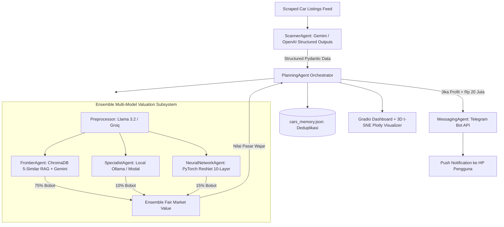

# 🚗 AutoBargain AI — Autonomous Used Car Arbitrage Multi-Agent System

[](https://www.python.org/downloads/)
[]()
[]()
[](LICENSE)

> **AutoBargain AI** adalah sistem Multi-Agent otonom tingkat lanjut yang mendeteksi peluang arbitrase (*mispriced / undervalued cars*) di pasar mobil bekas secara *real-time*. 
> Menggabungkan **RAG (Retrieval-Augmented Generation)** pada Vector Database ChromaDB, **PyTorch Deep Residual Network (10-Layer ResNet)**, **Structured Outputs (Pydantic)**, notifikasi push instan ke **Telegram**, serta dashboard interaktif **Gradio** dengan visualisasi **3D Vector Embedding Space**.

---

## 🌟 Fitur Utama & Arsitektur



### 🧠 Modul Agen di dalam Sistem:
1. **`ScannerAgent`**: Mengekstrak spesifikasi teknis mobil dan harga tawar menggunakan **OpenAI / Google Gemini Structured Outputs (Pydantic)**.
2. **`Preprocessor`**: Menstandarisasi deskripsi iklan yang kotor menjadi parameter kendaraan terstruktur.
3. **`FrontierAgent`**: Mencari **5 mobil paling identik** di **ChromaDB** menggunakan `sentence-transformers/all-MiniLM-L6-v2` dan meminta Frontier LLM menaksir harga pasar wajar (*in-context few-shot learning*).
4. **`NeuralNetworkAgent`**: Jaringan syaraf tiruan **PyTorch 10-Layer Deep Residual Network** dengan *Skip Connections* untuk regresi numerik murni.
5. **`SpecialistAgent`**: Model spesialis pasar mobil lokal (via Ollama lokal atau Modal Serverless GPU).
6. **`EnsembleAgent`**: Menghitung bobot gabungan nilai wajar pasar ($75\% \text{ RAG} + 15\% \text{ PyTorch NN} + 10\% \text{ Specialist}$).
7. **`MessagingAgent`**: Mengirim alert push instan ke aplikasi **Telegram** smartphone pengguna lengkap dengan copywriting persuasif buatan AI.
8. **`PlanningAgent`**: Menghitung selisih keuntungan (`Estimasi Pasar - Harga Iklan`). Jika keuntungan $\ge \text{Rp 20 Juta}$, sistem mengirimkan notifikasi.

---

## ⚡ Panduan Instalasi & Menjalankan (5 Menit)

### 1. Clone & Masuk ke Folder
```bash
cd autobargain_ai
```

### 2. Buat Virtual Environment & Install Dependensi
```bash
python3 -m venv .venv
source .venv/bin/activate  # Di Windows: .venv\Scripts\activate
pip install -r requirements.txt
```

### 3. Konfigurasi Environment Variable (`.env`)
Salin template `.env.example` menjadi `.env`:
```bash
cp .env.example .env
```
Buka file `.env` dan masukkan API Key gratis Anda:
- `GEMINI_API_KEY`: Dapatkan gratis di [Google AI Studio](https://aistudio.google.com/).
- `TELEGRAM_BOT_TOKEN` & `TELEGRAM_CHAT_ID`: Dapatkan gratis via `@BotFather` di aplikasi Telegram.
- *(Opsional)* `GROQ_API_KEY`: Dapatkan gratis di [Groq Console](https://console.groq.com/).

### 4. Populasi Vector Store (ChromaDB)
Jalankan script berikut untuk memasukkan database mobil awal ke ChromaDB:
```bash
python seed_database.py
```

### 5. Jalankan Web Dashboard
```bash
python app.py
```
Buka browser di `http://127.0.0.1:7860`. Anda akan melihat antarmuka dashboard interaktif dengan log terminal real-time dan visualisasi 3D Vector Space!

---

## 📊 Tech Stack (100% Free-Tier Compatible)

| Lapisan Sistem | Teknologi yang Digunakan | Biaya |
| :--- | :--- | :--- |
| **Frontier LLM & Extraction** | Google Gemini 2.0 Flash / Groq Llama 3.3 | **Gratis ($0)** |
| **Vector Database & Search** | ChromaDB + `sentence-transformers/all-MiniLM-L6-v2` | **Gratis ($0)** |
| **Deep Learning Inference** | PyTorch 10-Layer ResNet (Local CPU / MPS / CUDA) | **Gratis ($0)** |
| **Push Notification Alerting** | Telegram Bot API | **Gratis ($0)** |
| **User Interface & 3D Plot** | Gradio 5.0 + Plotly 3D t-SNE | **Gratis ($0)** |
| **Data Contract & Validation**| Pydantic v2 | **Gratis ($0)** |

---

## 📄 Lisensi
Didistribusikan di bawah Lisensi MIT. Bebas digunakan untuk portofolio dan proyek komersial.
