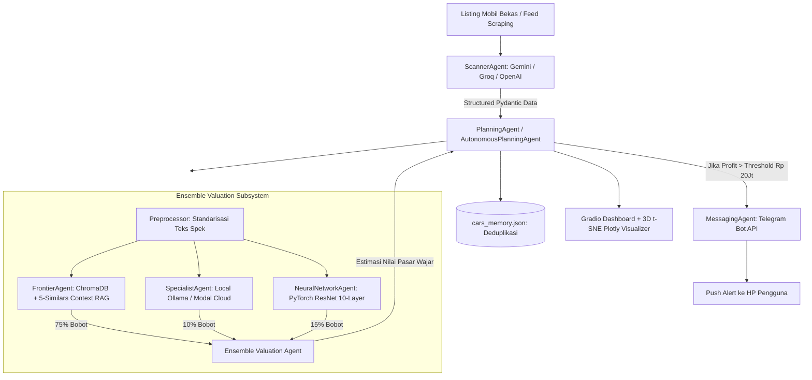

# 📑 Product Requirement Document (PRD)
# AutoBargain AI — Autonomous Used Car Arbitrage Multi-Agent System

---

## 1. Executive Summary & Vision
**AutoBargain AI** adalah sistem Multi-Agent cerdas dan otonom yang dirancang untuk mendeteksi peluang arbitrase di pasar mobil bekas secara *real-time*. Sistem ini secara otomatis:
1. Memindai listing mobil baru di internet.
2. Mengekstrak spesifikasi dan harga tawaran menggunakan *Structured Outputs*.
3. Menaksir harga wajar pasar (*true market value*) menggunakan arsitektur **Ensemble AI** (RAG Vektor 5-Similars + PyTorch Deep Residual Neural Network + Small Language Model Spesialis).
4. Menghitung potensi profit/diskon (`Estimasi Harga Pasar - Harga Tawaran Penjual`).
5. Mengirimkan notifikasi instan ke smartphone via Telegram Bot jika terdeteksi mobil *undervalued* (misal selisih > Rp 20.000.000,-).
6. Menyajikan dashboard interaktif berbasis Gradio dengan visualisasi 3D Vector Space t-SNE.

---

## 2. Core Architecture & Workflow Diagram

---

## 3. Data Contracts & Pydantic Schemas

### `CarDeal`
Mewakili data listing mobil bersih yang diekstrak dari iklan.
- `title` (`str`): Judul ringkas mobil (contoh: *"Honda Civic 1.5 Turbo Prestige 2019"*).
- `brand` (`str`): Merk kendaraan (*Toyota, Honda, Mitsubishi, BMW, Mercedes, dll.*).
- `year` (`int`): Tahun pembuatan.
- `mileage_km` (`int`): Jarak tempuh / Odometer dalam kilometer.
- `transmission` (`str`): *Automatic* / *Manual*.
- `condition_notes` (`str`): Catatan kondisi bodi, riwayat servis, dan kelengkapan surat (BPKB/STNK).
- `price_idr` (`float`): Harga yang diminta oleh penjual dalam Rupiah.
- `url` (`str`): Tautan ke iklan listing mobil.

### `CarSelection`
- `deals` (`List[CarDeal]`): Kumpulan maksimal 5 mobil paling terverifikasi dari hasil scan.

### `CarOpportunity`
Mewakili peluang arbitrase / keuntungan yang terdeteksi.
- `deal` (`CarDeal`): Objek data mobil.
- `estimated_value_idr` (`float`): Taksiran harga pasar wajar dari Ensemble AI.
- `discount_idr` (`float`): Potensi keuntungan / selisih (`estimated_value_idr - deal.price_idr`).
- `discount_percentage` (`float`): Persentase diskon terhadap harga pasar.

---

## 4. Spesifikasi Modul Agen (`agents/`)

### 1. `BaseAgent` (`agents/agent.py`)
- Menyediakan fungsi logging thread-safe dengan kode warna ANSI terminal unik per agen (Cyan, Blue, Red, Yellow, Magenta, Green, White).

### 2. `Preprocessor` (`agents/preprocessor.py`)
- **Tujuan**: Menghilangkan teks iklan yang tidak relevan (seperti *"dijual cepat bu", "bisa nego halus"*) dan menyusunnya menjadi format spesifikasi standar: `Brand | Model | Tahun | Transmisi | KM | Kondisi Mesin/Bodi`.
- **Model**: LiteLLM / Gemini 2.0 Flash / Groq Llama 3.3.

### 3. `ScannerAgent` (`agents/scanner_agent.py`)
- **Tujuan**: Membaca artikel / feed mobil mentah dan mengubahnya menjadi format `CarSelection` Pydantic menggunakan **Structured Outputs**.
- **Model**: `gemini-2.0-flash` (Gratis) atau `gpt-4o-mini`.

### 4. `FrontierAgent` (`agents/frontier_agent.py`)
- **Tujuan**: Mengambil 5 mobil yang paling mirip spesifikasinya dari ChromaDB menggunakan embedding `all-MiniLM-L6-v2`.
- Memasukkan 5 data historis tersebut sebagai *few-shot in-context learning* ke Frontier LLM untuk memprediksi harga pasar wajar.

### 5. `DeepNeuralNetwork` & `NeuralNetworkAgent` (`agents/deep_neural_network.py` & `agents/neural_network_agent.py`)
- **Tujuan**: Menjalankan inferensi Deep Learning murni (PyTorch) 10-Layer Residual Network dengan *Skip Connections* dan `HashingVectorizer(5000)`.

### 6. `SpecialistAgent` (`agents/specialist_agent.py`)
- **Tujuan**: Mengakses model Small Language Model lokal (via Ollama `llama3.2`) atau remote cloud container (Modal.com).

### 7. `EnsembleAgent` (`agents/ensemble_agent.py`)
- **Tujuan**: Menggabungkan hasil ketiga model penilai:
  $$\text{Harga Final} = (0.75 \times \text{Frontier RAG}) + (0.15 \times \text{PyTorch NN}) + (0.10 \times \text{Specialist})$$

### 8. `MessagingAgent` (`agents/messaging_agent.py`)
- **Tujuan**: Mengirim pesan alert instan ke Telegram Bot API (`https://api.telegram.org/bot<token>/sendMessage`) lengkap dengan format Markdown dan emoji menarik.

### 9. `PlanningAgent` (Deterministik) & `AutonomousPlanningAgent` (ReAct)
- **`PlanningAgent`**: Menjalankan pipeline sekuensial yang pasti: *Scan $\rightarrow$ Preprocess $\rightarrow$ Ensemble Price $\rightarrow$ Sort Discount $\rightarrow$ Filter $(> \text{Threshold}) \rightarrow$ Alert Telegram $\rightarrow$ Save Memory*.
- **`AutonomousPlanningAgent`**: Mengimplementasikan ReAct Tool Calling Loop di mana LLM memilih tools (`scan_car_market`, `estimate_car_fair_value`, `notify_car_deal`) secara dinamis.

---

## 5. Antarmuka Pengguna & Dashboard (`app.py`)
- **Framework**: Gradio Web UI + Plotly 3D Graph.
- **Fitur Utama**:
  1. **Live Streaming Log Terminal**: Log berwarna dari setiap agen di-stream ke komponen HTML secara asinkron menggunakan *worker thread* dan `queue.Queue`.
  2. **Tabel Peluang Mobil Murah**: Menampilkan daftar mobil dengan diskon terbesar, harga jual, estimasi wajar, dan tautan.
  3. **Visualisasi 3D Vector Space (t-SNE)**: Mengurangi dimensi embedding ChromaDB menjadi grafik sebaran 3D interaktif yang dikelompokkan berdasarkan Merk dan Kategori Kendaraan.
  4. **Auto-Scanning Timer**: Berjalan otomatis setiap interval tertentu (misal 5 menit).
  5. **Interactive Click Alert**: Mengklik salah satu baris mobil di tabel akan langsung mentrigger notifikasi ulang ke Telegram.

---

## 6. Zero-Cost / Free-Tier Tech Stack

| Komponen | Pilihan Gratisan Terpasang |
| :--- | :--- |
| **Frontier LLM & Extraction** | Google Gemini 2.0 Flash (Free API) / Groq Llama 3.3 |
| **Vector Database & Embeddings** | ChromaDB Lokal + `sentence-transformers/all-MiniLM-L6-v2` |
| **Deep Learning Inference** | PyTorch Lokal (CPU / Apple Silicon MPS / Nvidia CUDA) |
| **Push Notification Alert** | Telegram Bot API (100% Gratis Selamanya) |
| **UI Dashboard & 3D Plot** | Gradio + Plotly Lokal |
| **Bahasa & Environment** | Python 3.10+ dengan `uv` atau `pip` |
